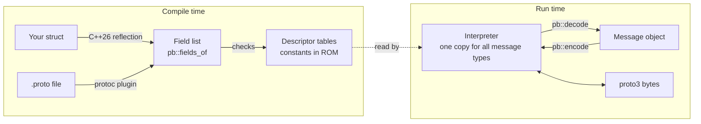
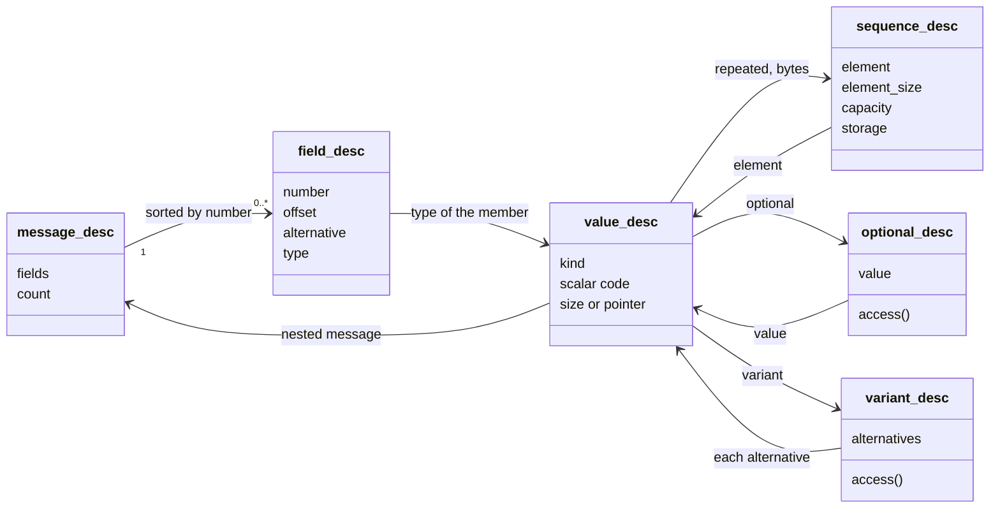
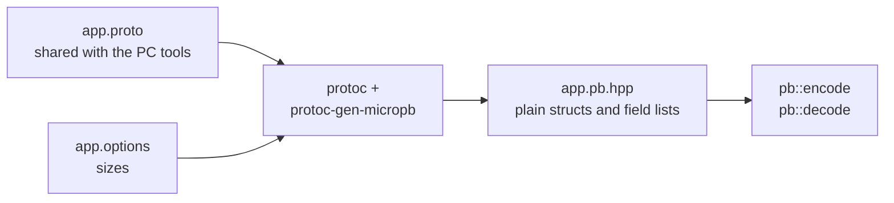
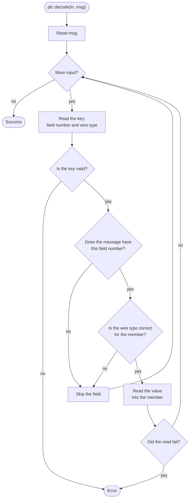
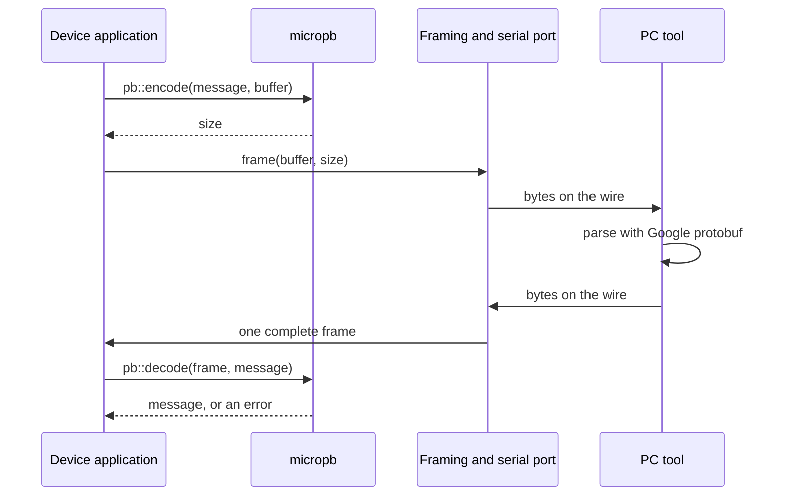
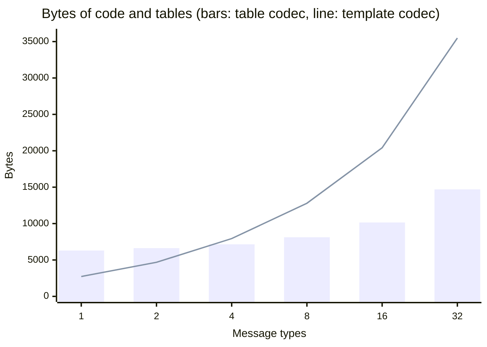

# micropb

A small proto3 encoder and decoder for C++26. Your plain structs are the schema.

`micropb` is made for embedded devices that send protobuf messages to PC tools, for example on a USB serial port. It uses C++26 static reflection, so the C++ side needs no `.proto` file, no code generator and no macro. When you already have `.proto` files, a `protoc` plugin writes the structs from them. Those generated structs also work on a C++23 compiler that has no reflection.

```cpp
struct ping {
    std::uint32_t seq;
};

std::array<std::uint8_t, 16> buffer{};
const auto size = pb::encode(ping{7}, buffer); // 08 07
```

## Contents

* [Features](#features)
* [Example](#example)
* [How it works](#how-it-works)
* [Add it to a project](#add-it-to-a-project)
* [Define messages](#define-messages)
* [Generate structs from a .proto file](#generate-structs-from-a-proto-file)
* [Compilers without reflection](#compilers-without-reflection)
* [Encode](#encode)
* [Decode](#decode)
* [Errors](#errors)
* [Compile-time checks](#compile-time-checks)
* [Talk to a PC tool](#talk-to-a-pc-tool)
* [Code size](#code-size)
* [Build and test](#build-and-test)
* [Repository layout](#repository-layout)
* [Status and limits](#status-and-limits)
* [License](#license)

## Features

* **Structs are the schema.** A message is an aggregate struct. Field numbers come from the order of the members.
* **Three functions.** `pb::encode`, `pb::decode` and `pb::encoded_size`.
* **Small code.** One interpreter encodes and decodes all message types. Each more message type adds a constant table, not a copy of the codec.
* **No heap, no exceptions, no RTTI.** Errors are `std::expected` values. All storage is in your structs or in buffers that you supply.
* **Zero-copy decode** of strings and bytes: a `std::string_view` or a `std::span` points into the input buffer.
* **Same bytes as `protoc`.** The tests compare the output with reference vectors from the Google C++ runtime.
* **Mistakes are compile errors.** A duplicate field number or a type without a proto3 mapping does not compile.
* **Header-only.** Five headers, standard library only.
* **Reflection is optional.** A message with a field list works on a C++23 compiler. The `protoc` plugin writes the field lists.

## Example

```cpp
#include <array>
#include <cstdint>
#include <span>
#include <variant>

#include <micropb/micropb.hpp>

struct pose {
    pb::repeated<float, 3> pos;
    pb::repeated<float, 4> rot;
};

struct ping {
    std::uint32_t seq;
};

struct envelope {
    std::uint32_t id;
    std::variant<std::monostate, pose, ping> payload; // oneof
};

bool send_and_receive() {
    std::array<std::uint8_t, 64> buffer{};
    const auto size = pb::encode(envelope{1, ping{7}}, buffer); // std::expected<std::size_t, pb::error>
    if (!size)
        return false;

    envelope in{};
    const auto used = pb::decode(std::span<const std::uint8_t>(buffer).first(*size), in);
    if (!used)
        return false;

    const auto* received = std::get_if<ping>(&in.payload);
    return in.id == 1 && received && received->seq == 7;
}
```

The encoded message has 6 bytes:

| Bytes | Meaning |
| --- | --- |
| `08 01` | field 1 (`id`), varint, value 1 |
| `1a 02` | field 3 (`ping`, the second alternative of `payload`), 2 bytes follow |
| `08 07` | in `ping`: field 1 (`seq`), varint, value 7 |

## How it works

Each message type has a field list: the type, the number and the offset of each member. Reflection reads the struct at compile time and makes this list. For a `.proto` file, the `protoc` plugin writes the list into the generated header, so that no reflection is necessary. Templates make a constant table from the list. At run time, one interpreter reads the tables.



A descriptor table tells the interpreter where each field is in the struct and how to read and write it. All fields of the same type share one value descriptor.



* The interpreter reads and writes scalars with `std::memcpy`, through the byte offset of the member.
* `std::optional` and `std::variant` have no layout that the standard specifies. The interpreter uses them only through one small accessor function for each type.
* The tables are `constexpr` objects. The linker puts them in read-only memory, and there is no initialization at run time.

## Add it to a project

**Requirements:** GCC 16.2 or newer with `-std=c++26 -freflection`. No other compiler has been used. For a compiler without reflection, see [Compilers without reflection](#compilers-without-reflection).

With CMake, add the directory and link the `micropb` target. The target is an `INTERFACE` library: it gives the include directory, C++26 and `-freflection`. The target `micropb_cxx23` gives the include directory and C++23 only.

```cmake
add_subdirectory(micropb)
target_link_libraries(firmware PRIVATE micropb)
```

Without CMake, add `src/` to the include path and compile with `-std=c++26 -freflection`.

Include one header:

```cpp
#include <micropb/micropb.hpp>
```

The library does not use exceptions or RTTI, so `-fno-exceptions -fno-rtti` are safe.

## Define messages

A message is a class aggregate: only public data members, no base class, no constructor.

### Type mapping

| C++ type | proto3 type | Notes |
| --- | --- | --- |
| `bool` | `bool` | |
| `std::int32_t`, `std::int64_t` | `int32`, `int64` | A negative value is a 10-byte varint. |
| `std::uint32_t`, `std::uint64_t` | `uint32`, `uint64` | |
| `std::int8_t`, `std::int16_t` | `int32` | Decode truncates to the width of the member. |
| `std::uint8_t`, `std::uint16_t` | `uint32` | Decode truncates to the width of the member. |
| `pb::sint32`, `pb::sint64` | `sint32`, `sint64` | ZigZag: small for negative values. |
| `pb::fixed32`, `pb::fixed64` | `fixed32`, `fixed64` | |
| `pb::sfixed32`, `pb::sfixed64` | `sfixed32`, `sfixed64` | |
| `float`, `double` | `float`, `double` | |
| `enum`, `enum class` | `enum` | `int32` on the wire. An enum wider than 32 bits does not compile. |
| `std::string_view` | `string` | Decode gives a view into the input. |
| `std::span<const std::uint8_t>` | `bytes` | Decode gives a view into the input. |
| `std::array<std::uint8_t, N>` | `bytes` | Fixed length, see [Bytes](#bytes). |
| struct | `message` | A nested message. |
| `std::optional<T>` | `optional T` | Explicit presence. |
| `std::variant<std::monostate, A, B>` | `oneof` | `std::monostate` means that no alternative is set. |
| `pb::repeated<T, N>` | `repeated T` | See [Repeated fields](#repeated-fields). |

Use only the fixed-width integer types of `<cstdint>`. They mean the same on each target: `std::int32_t` is `int` on a PC, but `long` on `arm-none-eabi`. A type such as `long` or `char` does not compile when it is not one of these aliases on the target.

`pb::sint32` and the other `pb::` integer types are small wrappers. They convert to and from the integer type that they hold:

```cpp
struct sample {
    pb::sint32 delta;
};

sample s{-5};
std::int32_t value = s.delta; // -5
```

### Field numbers

The first member has the field number 1. Each next member has the previous number + 1.

* `[[= pb::tag{N}]]` sets the number of a member to `N`. The members after it continue from `N + 1`.
* A `std::variant` uses one number for each alternative after `std::monostate`, in order.
* `[[= pb::oneof_tags<A, B, ...>{}]]` sets the numbers of the alternatives of a `std::variant`. The members after it continue from the last number + 1.

```cpp
struct status {
    std::uint32_t uptime;                            // 1
    std::uint32_t errors;                            // 2
    [[= pb::tag{10}]] float temperature;             // 10
    float voltage;                                   // 11
    std::variant<std::monostate, pose, ping> detail; // pose = 12, ping = 13
    [[= pb::oneof_tags<20, 21>{}]]                   //
    std::variant<std::monostate, pose, ping> extra;  // pose = 20, ping = 21
    bool ready;                                      // 22
};
```

The encoder writes the fields in ascending field number, also when the numbers are not in the order of the members.

> [!IMPORTANT]
> Field numbers are the contract with the other side of the link. A new member in the middle of a struct changes the numbers of all members after it. Add new members at the end, or give the members explicit numbers with `pb::tag`.

### Presence

| Member | When the encoder writes it |
| --- | --- |
| scalar, string, bytes | when the value is not zero or not empty |
| `std::optional<T>` | when it has a value, also when the value is zero |
| nested message | always |
| `std::optional<message>` | when it has a value |
| `std::variant` | the active alternative only |
| repeated field | when it has one element or more |

`-0.0` is not zero for this rule. The encoder writes it, as the Google C++ runtime does.

### Repeated fields

Scalar elements are packed. Strings, bytes and messages are one field for each element.

| Container | Storage | Encode | Decode |
| --- | --- | --- | --- |
| `pb::repeated<T, N>` | in the struct, up to `N` elements | yes | yes |
| `pb::span_buffer<T>` | a span that you supply | yes | yes |
| `std::array<T, N>` | in the struct, always `N` elements | yes | no |
| `std::span<const T>` | a view of your data | yes | no |

`pb::repeated<T, N>` is a small sequence with a fixed capacity: `push_back` (returns `false` when it is full), `size`, `capacity`, `empty`, `clear`, `operator[]`, `begin` and `end`.

`pb::span_buffer<T>` keeps its elements in storage that you supply. Give it the storage before you decode:

```cpp
struct samples {
    pb::span_buffer<std::int32_t> values;
};

std::array<std::int32_t, 256> storage{};
samples received{pb::span_buffer<std::int32_t>(storage)};
const auto result = pb::decode(input, received);
```

A `pb::span_buffer` can be a member of the top-level message or of a nested message. It cannot be in a `std::optional`, in a `std::variant`, or in the element of a repeated field: use `pb::repeated` there.

### Bytes

| Type | Encode | Decode |
| --- | --- | --- |
| `std::span<const std::uint8_t>` | yes | yes: a view into the input, no copy |
| `pb::repeated<std::uint8_t, N>` | yes | yes: a copy, up to `N` bytes |
| `pb::span_buffer<std::uint8_t>` | yes | yes: a copy into your storage |
| `std::array<std::uint8_t, N>` | yes, always `N` bytes | yes, see below |
| `std::span<const std::uint8_t, N>` | yes | no |

A `std::array<std::uint8_t, N>` is a bytes field with a fixed length, for example a MAC address. On decode, input that is shorter than `N` leaves the remaining bytes 0. Input that is longer than `N` is the error `CAPACITY_EXCEEDED`.

## Generate structs from a .proto file

When a project already has `.proto` files, you do not have to write the structs. `tools/protoc-gen-micropb.py` is a plugin for `protoc`. It reads a proto3 file and writes a header with the structs. It needs Python 3.8 or newer and the Python package `protobuf`. (It is tested only with Python 3.14.)



```sh
protoc --plugin=protoc-gen-micropb=tools/protoc-gen-micropb.py --micropb_out=gen --micropb_opt=options_dir=proto -I proto proto/app.proto
```

This command writes `gen/app.pb.hpp`. The folder `gen` must exist. On Windows, use `tools\protoc-gen-micropb.bat` as the plugin, because `protoc` cannot start a `.py` file there.

`proto/app.proto`:

```proto
syntax = "proto3";
package app;

enum Mode {
  MODE_IDLE = 0;
  MODE_RUN = 1;
}

message Sample {
  uint32 time = 1;
  repeated float values = 2;
  bytes mac = 3;
  optional sint32 offset = 10;
  Mode mode = 11;
}
```

`proto/app.options`:

```text
# <name pattern>  <option>:<value> ...
Sample.values     max_count:8
Sample.mac        max_size:6 fixed_length:true
```

`gen/app.pb.hpp`:

```cpp
// Generated by protoc-gen-micropb from app.proto. Do not edit.
#pragma once

#include <array>
#include <cstddef>
#include <cstdint>
#include <optional>

#include <micropb/types.hpp>

namespace app {

enum class Mode : std::int32_t {
    IDLE = 0,
    RUN = 1,
};

struct Sample {
    std::uint32_t time;
    pb::repeated<float, 8> values;
    std::array<std::uint8_t, 6> mac;
    std::optional<pb::sint32> offset;
    Mode mode;
};

} // namespace app

// Field lists: with these, the messages also work on a compiler without reflection.

template <>
struct pb::fields_of<::app::Sample> : pb::field_list<::app::Sample,
    pb::field_at<decltype(::app::Sample::time), 1, offsetof(::app::Sample, time)>,
    pb::field_at<decltype(::app::Sample::values), 2, offsetof(::app::Sample, values)>,
    pb::field_at<decltype(::app::Sample::mac), 3, offsetof(::app::Sample, mac)>,
    pb::field_at<decltype(::app::Sample::offset), 10, offsetof(::app::Sample, offset)>,
    pb::field_at<decltype(::app::Sample::mode), 11, offsetof(::app::Sample, mode)>> {};
```

The structs are plain structs. The field lists after them give each member its field number. With them, the header needs no reflection and no annotation, see [Compilers without reflection](#compilers-without-reflection).

### What the plugin writes

The types are those of the table in [Type mapping](#type-mapping). These rules are specific to the plugin:

* **Names** stay as they are in the `.proto` file. A name that is a C++ keyword gets the suffix `_`: `class` becomes `class_`. The same applies to `pb`, `std` and the common macro names `NULL`, `EOF`, `errno`, `stdin`, `stdout`, `stderr`, `assert` and `offsetof`. A name that is a different macro in your project, for example `HIGH`, is not changed and does not compile.
* **Package:** `package a.b` becomes `namespace a::b`.
* **Enum values** lose the prefix `<ENUM NAME>_` when each value of the enum has it and the remaining text starts with a letter. `MODE_IDLE` of `Mode` becomes `Mode::IDLE`. The comparison ignores case. For a nested enum, the prefix is the name of the enum without the outer message: `STATE_` for `Device.State`.
* **Nested types** become top-level types: `Outer.Inner` is `Outer_Inner`.
* **Order:** the enums come first. Each struct comes after the structs that it contains, also when the `.proto` file has a different order.
* **Field numbers** are in the field list after the structs. The structs have no `pb::tag` annotation, because an annotation is C++26.
* **`oneof`** becomes a `std::variant` with the name of the `oneof`. The names of its members are not in the C++ code.
* **A message field without `optional`** is a plain member. The encoder always writes it, see [Presence](#presence).
* **`string`** is always a `std::string_view`, and `bytes` without an option is a `std::span<const std::uint8_t>`.
* **`import`** becomes `#include "<name>.pb.hpp"` when the file uses a type of the imported file. A type of a different package gets its full name, `::a::b::name`.

### The options file

A `.proto` file does not say how many elements a repeated field can have. The plugin reads these sizes from `<name>.options`, a text file in the format of NanoPB options files. Each line has a name pattern and then one or more options. `#` and `//` start a comment.

| Option | For | Result |
| --- | --- | --- |
| `max_count:N` | a repeated field | `pb::repeated<T, N>` |
| `max_count:N fixed_count:true` | a repeated field | `std::array<T, N>` (encode only) |
| `max_size:N` | a `bytes` field | `pb::repeated<std::uint8_t, N>` |
| `max_size:N fixed_length:true` | a `bytes` field | `std::array<std::uint8_t, N>` |
| `int_size:IS_8`, `IS_16`, `IS_32`, `IS_64` | `int32`, `int64`, `uint32`, `uint64` | `std::int8_t` ... `std::uint64_t`, with the sign of the field |

* The pattern is the name of the field: `package.Message.field`, or `Message.field` without the package. `*` and `?` are wildcards, thus `* max_count:8` sets a default for all fields.
* When more than one line sets the same option for a field, the last line wins.
* Each repeated field must have a `max_count`. The plugin stops with an error when one is missing.
* The plugin looks for `<name>.options` with the path that `protoc` has for the `.proto` file, from the current folder. Give more folders with `--micropb_opt=options_dir=<folder>`.
* An option that the plugin does not know and a pattern that matches no field give a warning. An option that does not apply to its field gives a warning when its line has no wildcard. Thus a simple options file of NanoPB works, and a typing error is visible. `max_size` on a `string` field is such a case: a string has no storage in the struct.
* The file must be UTF-8 text.

### What the plugin does not accept

The plugin stops with an error for: a file that is not proto3, a `map` field, a message that contains itself, a `oneof` with two members of the same type, and `int_size:IS_8` on a repeated unsigned field (the library reads a sequence of `std::uint8_t` as `bytes`). It ignores services and `extend` blocks. It also ignores `[packed = false]`: the library always packs scalar elements, and each protobuf parser reads the two forms.

The plugin does not read options that are in the `.proto` file, such as `[(nanopb).max_size = 6]`. When it finds no options file, a `bytes` field is a `std::span` and an integer has its full size, without a message. Thus make sure that the options file is found: see the rule for `options_dir` above.

## Compilers without reflection

Reflection has one task in `micropb`: it finds the members of a struct and makes the field list. All other code is C++23. Thus a message type that has a field list works on a compiler without reflection, with `-std=c++23`.

* **Generated structs:** `protoc-gen-micropb` writes a field list for each message. Include the generated header and `<micropb/micropb.hpp>`. Nothing more is necessary.
* **Your own structs:** write the field list, or use a compiler with reflection.

A field list is a specialization of `pb::fields_of`. It has one `pb::field_at` for each field: the type of the member, the field number and the offset of the member.

```cpp
struct ping {
    std::uint32_t seq;
    std::string_view note;
};

template <>
struct pb::fields_of<ping> : pb::field_list<ping,
    pb::field_at<decltype(ping::seq), 1, offsetof(ping, seq)>,
    pb::field_at<decltype(ping::note), 2, offsetof(ping, note)>> {};
```

* The entries can be in any order.
* The list is in the scope of `pb`. When your type has a name that `pb` also has, for example `tag` or `error`, write `::tag`.
* A `std::variant` member must have one entry for each alternative after `std::monostate`. The entry has the index of the alternative as a fourth argument: `pb::field_at<decltype(msg::choice), 10, offsetof(msg, choice), 1>`.
* `offsetof` is a macro. For a type with a comma in its name, such as `box<T, N>`, make an alias first.
* A `const` member is encode-only. Use `decltype`, which keeps the `const`.
* The specialization must come before the first use of the type with `pb::encode`, `pb::decode` or `pb::encoded_size`.
* A field list has priority over reflection. Thus a generated message uses the same table on each compiler.
* The rules of [Compile-time checks](#compile-time-checks) also apply to a field list, with the exception of the rules that need reflection: `not_aggregate`, `base_class`, `inaccessible_member`, `bit_field` and the rules for annotations.
* The tables are the same constants in ROM, and the code size is the same.

Without reflection and without a field list, a message type does not compile. The error is `pb: no_field_list`.

> [!WARNING]
> The compiler cannot compare a list that a person wrote with the struct. Always write `decltype(T::member)` and `offsetof(T, member)` with the same member, as in the example. An entry with a different type or a different offset compiles, and the codec then reads or writes the wrong memory. The library finds only these mistakes: a member that is in the list two times, a `std::variant` without all its alternatives, an offset that is not in the message, and the list of a different type. It does not find a member that is not in the list.

> [!NOTE]
> This was tested with GCC 16 in C++23 mode without `-freflection`. A test with an older compiler, for example the Arm GNU Toolchain, has not been done.

## Encode

```cpp
template <typename T>
std::size_t pb::encoded_size(const T& msg);

template <typename T>
std::expected<std::size_t, pb::error> pb::encode(const T& msg, std::span<std::uint8_t> out);
```

`encode` writes one message into `out` and returns the number of bytes. It never writes past `out`. When `out` is too small, it returns `pb::error::BUFFER_TOO_SMALL`, and the contents of `out` are not valid.

`encoded_size` returns the number of bytes that `encode` needs for this message. Use it when you do not know a safe buffer size:

```cpp
const std::size_t needed = pb::encoded_size(message);
```

## Decode

```cpp
template <typename T>
std::expected<std::size_t, pb::error> pb::decode(std::span<const std::uint8_t> in, T& msg);
```

`decode` reads exactly one message from `in`. On success it returns `in.size()`.



**What decode does**

* It resets `msg` first. You can use the same object again for each message that arrives. A `pb::repeated` and a `pb::span_buffer` keep their storage and get the size 0.
* A field number that the message does not have is skipped. The other side can add fields, and old firmware continues to work.
* A known field with a different wire type is also skipped.
* A scalar that occurs more than one time: the last value wins.
* A nested message that occurs more than one time: the occurrences merge, as protobuf requires.
* A `oneof`: the last alternative wins.
* A repeated scalar field can be packed or not packed, also mixed in one message.
* A varint that is too wide for the member loses its upper bits. A `bool` is `true` for each value that is not 0.
* An enum value that the enum does not name is kept as its integer value.
* On an error, `msg` holds the fields that were read before the error.

> [!WARNING]
> A `std::string_view` or a `std::span<const std::uint8_t>` in a decoded message points into the input buffer. Do not use it after the buffer changes or goes away. Copy the data if you must keep it.

`decode` does not make sure that a `string` field is correct UTF-8.

## Errors

`pb::error` is an `enum class`. `encode` and `decode` return it in a `std::expected`.

| Error | From | Meaning |
| --- | --- | --- |
| `BUFFER_TOO_SMALL` | encode | The output span is too short. |
| `TRUNCATED` | decode | The input ends in a field, or a length is larger than the remaining input. |
| `INVALID_VARINT` | decode | A varint is longer than 10 bytes or has more than 64 bits. |
| `INVALID_WIRE_TYPE` | decode | A key has the wire type 3, 4, 6 or 7. Groups are not supported. |
| `INVALID_TAG` | decode | A key has the field number 0, or a field number above 2^29 - 1. |
| `CAPACITY_EXCEEDED` | decode | A field has more elements or bytes than its container holds. |

The decoder examines the capacity of a container before it reads the next element.

## Compile-time checks

A message that the codec cannot handle correctly does not compile. Each error is a `static_assert` with a message that starts with `pb: <rule>:`.

**Field numbers**

| Rule | Cause |
| --- | --- |
| `duplicate_tag` | Two fields have the same field number. |
| `tag_zero` | A field number is 0. |
| `tag_too_large` | A field number is above 2^29 - 1. |
| `tag_reserved` | A field number is from 19000 to 19999, which protobuf reserves. |
| `tag_on_variant` | `pb::tag` is on a `std::variant`. Use `pb::oneof_tags`. |
| `oneof_tags_on_non_variant` | `pb::oneof_tags` is on a member that is not a `std::variant`. |
| `oneof_tags_count` | `pb::oneof_tags` does not list one number for each alternative. |

**Message types**

| Rule | Cause |
| --- | --- |
| `not_aggregate` | A message is not a class aggregate. |
| `base_class` | A message has a base class. |
| `inaccessible_member` | A message has a private or protected data member. |
| `bit_field` | A member is a bit-field. |
| `member_offset_too_large` | A member is at an offset above 65535 bytes. |
| `unmapped_type` | A member type has no proto3 mapping, for example `char`, `long` or a pointer. |
| `enum_too_wide` | An enum is wider than 32 bits. |

**Combinations that proto3 does not have**

| Rule | Cause |
| --- | --- |
| `variant_no_monostate` | The first alternative of a `std::variant` is not `std::monostate`. |
| `monostate_member` | `std::monostate` is used in a different place. |
| `variant_duplicate_alternative` | Two alternatives of a `std::variant` have the same type. |
| `variant_repeated_alternative`, `variant_optional_alternative`, `variant_variant_alternative` | An alternative is a repeated field, a `std::optional` or a `std::variant`. |
| `optional_repeated`, `optional_optional`, `optional_variant` | The value of a `std::optional` is a repeated field, a `std::optional` or a `std::variant`. |
| `repeated_repeated`, `repeated_optional`, `repeated_variant` | The element of a repeated field is a repeated field, a `std::optional` or a `std::variant`. |
| `span_buffer_in_optional`, `span_buffer_in_variant`, `span_buffer_in_repeated` | A `pb::span_buffer` is in a place where it cannot get its storage. |

**Field lists that a person wrote**

| Rule | Cause |
| --- | --- |
| `no_field_list` | The compiler has no reflection and the message type has no `pb::fields_of`. |
| `field_list_type` | `pb::fields_of<T>` derives from the `pb::field_list` of a different type. |
| `field_list_offset` | The offset of a `pb::field_at` is not in the message. Use `offsetof`. |
| `field_list_alternative` | A `std::variant` member does not have one entry for each alternative with its index, or a different member has an index. |
| `field_list_overlap` | Two entries name the same member. |

**Decode only**

| Rule | Cause |
| --- | --- |
| `decode_encode_only` | A repeated field is in a `std::array` or a `std::span<const T>`. |
| `decode_fixed_span` | A bytes field is in a `std::span` with a static extent. |
| `decode_const_member` | A message has a `const` member. A `const` member compiles for `encode`. |

## Talk to a PC tool

`micropb` writes and reads one message. It does not find the start and the end of a message in a stream of bytes. Your code must frame the messages, for example with a length before each message, or with COBS and a checksum.



The PC tool can use Google protobuf in each language, for example Python, C# or C++. It needs a `.proto` file that agrees with your structs. Until the `.proto` generator is available (see [Status and limits](#status-and-limits)), write it by hand: one field for each member, with the field numbers of [Field numbers](#field-numbers).

```proto
syntax = "proto3";

message Ping {
  uint32 seq = 1;
}
```

## Code size

The interpreter has a fixed size. Each message type adds only tables and the small accessor functions of its `std::optional` and `std::variant` members.

The numbers below are the size of one object file that encodes and decodes one envelope message with *n* message types as `oneof` alternatives. Each message type has 8 fields of mixed types. They include the code, the constants and the tables (GCC 16.2, `-Os`, x86-64).

| Message types | Table codec (this library) | A template codec, one copy for each type |
| ---: | ---: | ---: |
| 1 | 6293 | 2729 |
| 2 | 6633 | 4682 |
| 4 | 7149 | 7941 |
| 8 | 8119 | 12794 |
| 16 | 10153 | 20411 |
| 32 | 14700 | 35490 |



The template codec was the first design of this library. It was smaller for one or two message types and larger from four message types. One more message type costs about 280 bytes with the tables and about 940 bytes with the templates.

The price is speed: an interpreter is slower than code that the compiler makes for each message type. For a serial link this is not important.

The numbers are from a PC. No measurement on ARM is available at this time. `cmake --build .build --target size_report` prints the numbers for 16 and 32 message types on your machine.

## Build and test

```sh
cmake -S . -B .build -G Ninja
cmake --build .build
ctest --test-dir .build --output-on-failure
```

On Windows with MSYS2 UCRT64, add `-DCMAKE_CXX_COMPILER=C:/msys64/ucrt64/bin/g++.exe`, and put `C:\msys64\ucrt64\bin` in `PATH`: the test programs need the libstdc++ DLL from that folder.

The tests use the flags `-fno-exceptions -fno-rtti -Wall -Wextra -Werror`.

| Tests | What they examine | How |
| --- | --- | --- |
| `test_wire`, `test_types`, `test_schema` | wire primitives, containers, field numbers and type rules | `static_assert`, and again at run time |
| `test_codec` | the descriptor tables and one message with each kind of member | `static_assert` for the tables, run time for the codec |
| `test_encode`, `test_decode` | `encode` and `decode` against the reference vectors | run time |
| `test_wire_compat` | round trips, each prefix and each single changed byte of each vector | run time |
| `test_generated` | the headers that the `protoc` plugin wrote for `vectors.proto` and `features.proto`, against bytes from `protoc`. Each field list of the plugin has the members, offsets and alternatives that reflection finds | run time and `static_assert` |
| `test_field_list` | a field list that a person wrote: table, encode, decode | run time and `static_assert` |
| `*_cxx23`, `compile_fail.list_*`, `no_startup_code` | `test_wire`, `test_types`, `test_field_list` and `test_generated` built as C++23 without reflection. The tables need no code before `main()` | run time, `nm` |
| `generator` | `tools/protoc-gen-micropb.py`: each rule, each option, each error | Python `unittest`, runs the plugin through `protoc` |
| `compile_fail.*` | each rule of [Compile-time checks](#compile-time-checks) | the file must not compile, and the compiler output must name the rule |

The codec reads and writes struct members through byte offsets, so its tests cannot run in constant evaluation. A sanitizer build does that job:

```sh
cmake -S . -B .build-sanitize -G Ninja -DMICROPB_SANITIZE=ON
cmake --build .build-sanitize
ctest --test-dir .build-sanitize --output-on-failure
```

`MICROPB_SANITIZE` builds the tests with AddressSanitizer and UndefinedBehaviorSanitizer. On MinGW it uses `-fsanitize=undefined -fsanitize-undefined-trap-on-error`, because MinGW has no sanitizer run-time library.

### Plugin tests

The test `generator` is in CTest only when CMake finds Python with the package `protobuf`, and `protoc`. The tests find `protoc` in the environment variable `PROTOC`, in `PATH`, or in the Python package `grpcio-tools`. To use a specific Python, configure with `-DPython3_EXECUTABLE=<path>`.

`tests/vectors/vectors.pb.hpp`, `tests/generator/features.pb.hpp` and `tests/generator/shared.pb.hpp` are generated and checked in, so `test_generated` does not need `protoc`. The test `generator` fails when one of them is not current. To write them again:

```sh
MICROPB_UPDATE_GENERATED=1 python tests/generator/test_plugin.py CheckedInTest
```

### Reference vectors

`tests/vectors/` holds `vectors.proto` and one `<message>.<case>.txtpb` text-format file for each test case. `vectors.hpp` contains the bytes that `protoc --encode` writes for them. It is generated and checked in, so the build and the tests do not run `protoc`. `messages.hpp` has the C++ structs that agree with `vectors.proto`.

To make `vectors.hpp` again (MSYS2 `mingw-w64-ucrt-x86_64-protobuf`):

```sh
cmake -DPROTOC=C:/msys64/ucrt64/bin/protoc.exe -P tests/vectors/generate.cmake
```

The output is the same on each run. It has no timestamp and no absolute path. The script writes temporary files only to `.build/vectors/`.

## Repository layout

```text
src/micropb/
    micropb.hpp      include this header
    types.hpp        pb::error, pb::repeated, pb::span_buffer, pb::sint32 ..., pb::tag, pb::oneof_tags
    wire.hpp         reader and writer for varints, fixed-width values and keys
    meta_schema.hpp  type classification, compile-time checks, field lists from reflection
    codec.hpp        descriptor tables, interpreter, encoded_size, encode, decode
tools/
    protoc-gen-micropb.py   protoc plugin: .proto file -> header with structs
    protoc-gen-micropb.bat  starts the plugin on Windows
tests/
    test_*.cpp       the tests
    generator/       tests and test schemas of the protoc plugin
    compile_fail/    one file for each compile-time rule
    vectors/         reference vectors from protoc
    size/            the source of the size report
docs/superpowers/    design documents and implementation plans
```

## Status and limits

* **Compiler:** developed and tested with GCC 16.2 on Linux. The MSYS2 build of the table codec and the MinGW variant of `MICROPB_SANITIZE` are not yet verified.
* **Without reflection:** tested only as GCC 16.2 with `-std=c++23` and without `-freflection`. No older compiler has been used. The code needs `std::expected`, so GCC 12 or newer. Clang is not tested: it does not know the attribute `gnu::noclone` of the codec and gives a warning for it.
* **ARM:** not yet compiled or measured for an ARM target.
* **CMake:** `add_subdirectory` also adds the tests of `micropb` to your project.
* **`protoc` plugin:** tested on Linux with `protoc` 35.1 and the Python package `protobuf` 7.36. `tools/protoc-gen-micropb.bat` is not yet verified on Windows.
* **Planned:** a generator that writes the `.proto` file from the C++ structs.
* **Not supported:** `map`, proto2, groups, `Any` and the other well-known types, JSON, streaming encode or decode. Unknown fields are skipped and not kept.
* **Not `constexpr`:** `encode`, `decode` and `encoded_size` run only at run time.
* **Message size:** each member must be at an offset of 65535 bytes or less in its struct.
* **Recursion:** a message type cannot contain itself.

## License

BSD 3-Clause. See [LICENSE](LICENSE).
